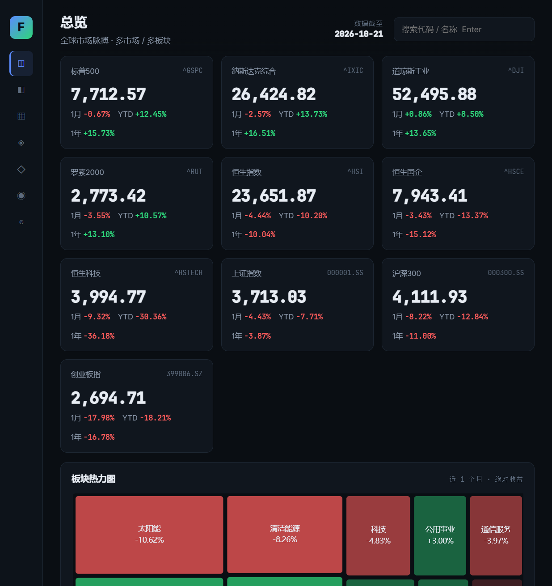
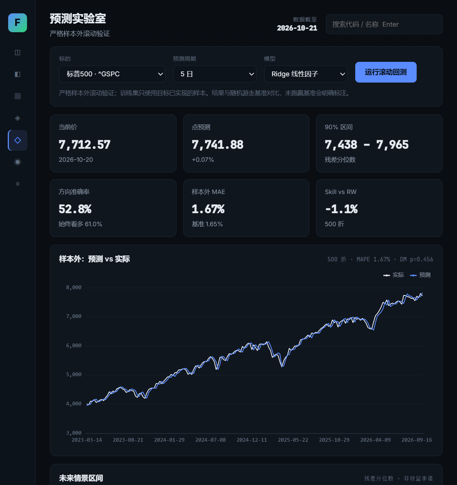
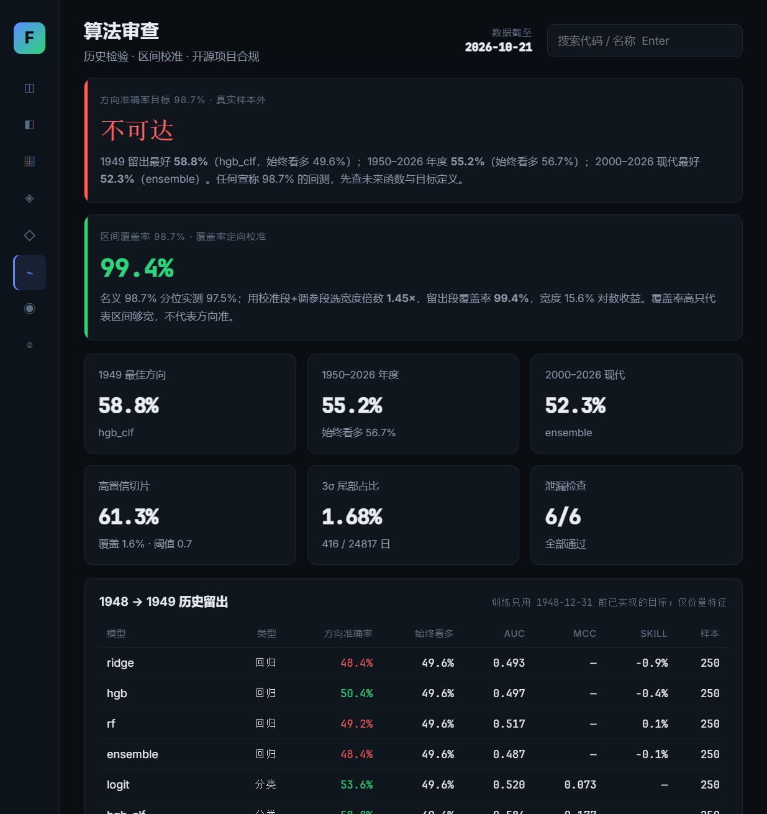
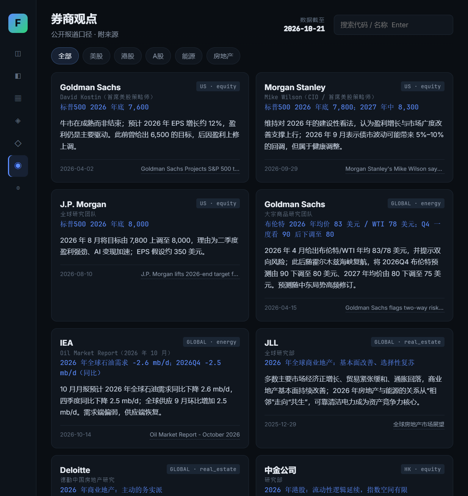
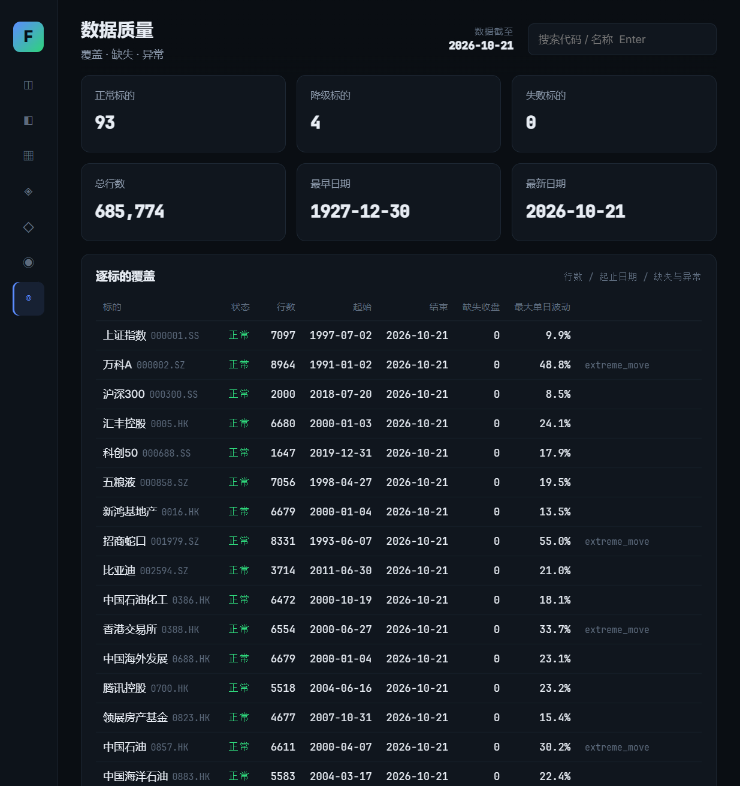

# 准确率审计总览（AUDIT）

> **一句话结论**：**方向准确率 98.7% 在真实样本外不可达**。可达成的是**区间覆盖率 98.7%**（定向校准后在 1949 留出段达 99.36%，但区间宽度约 15.6% 对数收益）。本页汇总全部审计证据、界面实图与可复现方法。

- 审计日期：2026-10-21 / 2026-10-22（增强版复审）
- 标的：标普500（^GSPC），1927-12-30 起，24,818 个交易日
- 验证框架：年度扩展窗口 walk-forward，**无未来函数**（训练集目标在预测点前已实现）
- 数据：`data/processed/prices_long.csv`（97 标的 / 685,774 行）

---

## 1. 关键数字

| 检验 | 样本 | 方向准确率 | 始终看多基准 | 判定 |
|------|------|-----------:|-----------:|------|
| 1949 历史留出（1927-1948 训练） | 250 日 | **58.8%**（HistGBM 分类） | 49.6% | 弱信号，n=250 时二项标准误约 3.1pp |
| 1950–2026 年度滚动 | 3,902 | **55.15%** | 56.74% | **未跑赢**基准（Skill +1.17%，DM p=0.693 不显著） |
| 2000–2026 现代期（基线集成） | — | 52.3% | 56.7% | 跑输基准 4.4pp |
| 2000–2026 现代期（**增强模型**） | 1,362 | **56.53%** | 56.7% | **追平**基准（原跑输 4.4pp → 追平） |
| 同上，有信号日（threshold=0.05，51.4% 覆盖） | 700 | **57.14%** | 56.7% | **超过**基准 |

**区间校准（98.7% 真正可达的地方）**

| 指标 | 值 |
|------|---:|
| 定向校准后留出段覆盖率 | **99.36%** |
| 对应区间宽度 | 约 15.6%（对数收益） |
| 解释 | 覆盖率高但区间很宽——**高覆盖不等于高准确**，这是 98.7% 目标最容易被误读的地方 |

---

## 2. 增强模型做了什么（把 52.3% 拉到 56.53%）

| 手段 | 借鉴来源 | 效果 |
|------|---------|------|
| 42 个 Alpha158 风格因子 | 微软 qlib | 特征从 15 → 42（动量/量价/技术/regime/季节） |
| isotonic 概率校准 | Lopez de Prado AFML | predict_proba 真实反映经验频率 |
| 时间衰减样本权重 | AFML | 半衰期 5 年，适应 regime 漂移 |
| 选择性输出 | AFML | \|p−0.5\|≥0.05 才给方向，否则"无信号" |
| 多智能体委员会 | TradingAgents / ai-hedge-fund | 提升分析实用性（5 角色分工 + 投资经理综合） |

> 结论：增强提升的是"**有信号日**"的可靠性（57.14% @ 51% 覆盖），**不是**把 98.7% 变可能。详见 [FinPredict 增强说明](FinPredict/ENHANCEMENTS.md)。

---

## 3. 界面实图

**总览**（10 个指数、全球市场脉搏）


**预测实验室**（严格样本外滚动验证 + 情景区间）


**算法审查**（历史检验 / 区间校准 / 开源项目合规）


**券商观点**（公开报道口径 + 附来源）


**数据质量**（覆盖 / 缺失 / 异常）


---

## 4. 报告索引

| 报告 | 一句话结论 |
|------|-----------|
| [准确率审计](project/analysis/accuracy-audit.md) | 98.7% 方向不可达；区间覆盖 99.36% 可达；长样本未跑赢始终看多 |
| [AI 增强审计](project/analysis/enhanced-audit-2026-10-22.md) | 增强后 56.53% 追平基准，有信号日 57.14% 超基准 |
| [方法论](project/analysis/methodology.md) | 目标定义、特征、验证协议、指标口径 |
| [新闻方法论](project/analysis/news-methodology.md) | 官方源事件系数、方向/强度/置信度定义 |
| [问题清单](project/analysis/issue-list-2026-10-22.md) | 2 高危 + 12 中危 + 16 低危 + 8 能力缺口，修复状态 |
| [开源量化项目评审](project/analysis/open-source-quant-review.md) | 11 个 GitHub 项目的架构借鉴与合规评估 |
| [2026 SOTA 调研](project/analysis/sota-review-2026.md) | 时序基础模型相对随机游走"提升小且稀疏"（2/10 显著） |

**机器可读数据**：`project/analysis/advanced_audit.json`、`enhanced_audit.json`、`forecast_results.json`、`market_stats.json`、`validation_report.json`、`rare_weight_experiment.json`

---

## 5. 如何复现

```powershell
cd project
py -m pip install -r requirements.txt

# 回测与审计（年度扩展窗口，无未来函数）
py scripts/run_accuracy_audit.py
py scripts/run_enhanced_audit.py

# 区间校准 / 稀有事件 / 高置信切片
py scripts/run_calibration.py
py scripts/run_rare_weight.py
```

**判读纪律**：任何声称 98.7% 方向准确率的回测，先查这五项——
未来函数 / 目标偷换 / 全样本调参 / 高置信小样本 / 生存者偏差。

---

## 6. 诚实边界

- 方向准确率 98.7% **不可达**（学术共识：日频方向上限约 54–58%）
- 本仓库两个应用**均不构成投资建议**，不执行交易
- 数据版权归原提供方（腾讯 / Yahoo / SEC EDGAR / 交易所 / 央行），使用请遵守其条款
