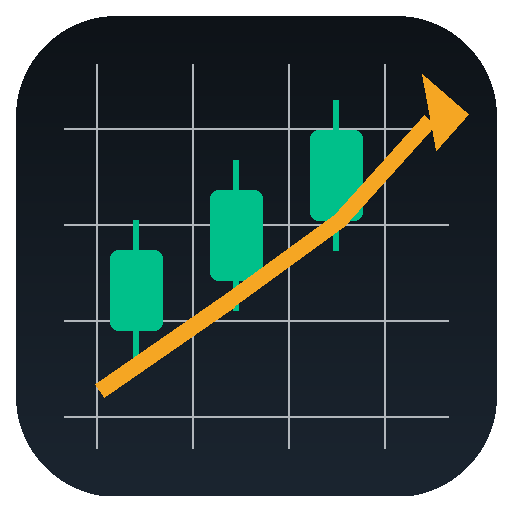
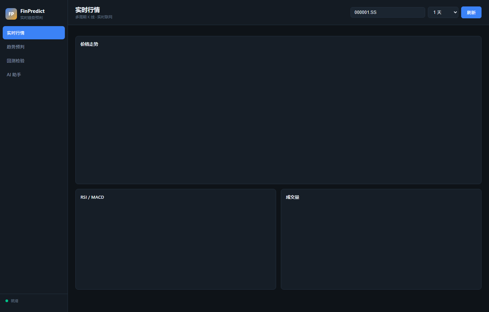

# FinPredict · Real-Time Financial Trend Forecasting Desktop App

**Language / Language / Langue / Язык / Idioma**: [中文](README.md) · [English](README_EN.md) · [Français](README_FR.md) · [Русский](README_RU.md) · [Español](README_ES.md)



A **double-click-to-run** Windows desktop app: fetches official market data live over the network, forecasts trends across multiple time horizons, validates with historical backtests, and includes built-in multi-agent AI analysis. No Python or any dependency installation required.



## ✨ Key Features

| Page | Capability |
|------|-----------|
| 📈 Live Quotes | Pulls candlesticks online across 4 horizons: 1 hour / 3 hours / 1 day / 1 month; candlestick + MA + Bollinger + RSI + MACD + volume |
| 🔮 Trend Forecast | Multi-horizon direction + median price + 95% confidence band (wider band for longer horizons); 42 factors + probability-calibrated ensemble |
| 🧪 Backtesting | Walk-forward rolling validation: directional accuracy / MAE / Skill / strategy equity vs buy-and-hold |
| 🤖 AI Assistant | OpenAI-compatible endpoints; 5 no-prompt-writing templates; **multi-agent committee** (technical / fundamental / risk / trader / manager roles, inspired by TradingAgents) |

## 🚀 Quick Start

**Option 1 (recommended)**: unzip and double-click `FinPredict.exe` — zero environment dependencies, data pre-fetched at launch (instant, no freeze).

**Option 2 (from source)**:
```powershell
py -m pip install -r requirements.txt
py -m finpredict.app
```

**Symbol examples**: `000001.SS` (SSE Composite) · `0700.HK` (Tencent) · `AAPL` (Apple) · `^GSPC` (S&P 500) · `CL=F` (WTI Crude)

## 📡 Data Sources (free, no API key)

| Market | Primary | Fallback |
|--------|---------|----------|
| China A-shares (.SS/.SZ), HK stocks (.HK), Hang Seng | Tencent Quotes | — |
| US stocks, US indices, commodities, FX | yfinance (3 retries) | graceful degradation when Yahoo rate-limits |

## 🤖 AI Integration (no prompt writing)

Fill in any OpenAI-compatible endpoint on the "AI Assistant" page:

| Endpoint | Base URL | Model |
|----------|----------|-------|
| Ollama (local) | `http://127.0.0.1:11434/v1` | `qwen2.5:7b` |
| DeepSeek | `https://api.deepseek.com/v1` | `deepseek-chat` |
| OpenAI | `https://api.openai.com/v1` | `gpt-4o-mini` |

**Prompt templates** (auto-filled with live quote/forecast/backtest data): Trend Analysis · Anomaly Explanation · Factor Attribution · Action Advice · Backtest Review

**Committee mode**: one click runs a 5-role multi-agent analysis — technical analyst, fundamental analyst, risk analyst, and trader each assess independently; the portfolio manager weighs all views and delivers the final conclusion (architecture inspired by TradingAgents / ai-hedge-fund, independently implemented).

## 🧮 Forecasting Method

- **Features**: 42 Alpha158-style factors (momentum / price-volume / technical / regime / seasonal, inspired by Microsoft qlib)
- **Models**: Ridge + HistGradientBoosting regression ensemble; direction probabilities calibrated via isotonic regression (Logit+HistGBM+ExtraTrees) with time-decay sample weights
- **Validation**: expanding-window walk-forward, no look-ahead; bands from rolling residual quantiles
- **Inspired by**: qlib (factor engineering) · TradingAgents (multi-agent committee) · ai-hedge-fund (multi-style views) · Lopez de Prado AFML (calibration + selective output) — architecture ideas only, zero code copied

## ⚠️ Honest Boundaries

**98.7% directional accuracy is not achievable out of sample** (academic consensus; the ceiling for daily directional forecasting is roughly 54-58%). Forecasts are scenario references only — not trading advice, no trade execution.

## 📦 Packaging

```powershell
py -m pip install pyinstaller
py -m PyInstaller finpredict.spec --noconfirm
```

## 📄 License

For research and education. Data copyrights belong to the original providers (Tencent / yfinance); please comply with their terms.

---

**Related project**: the `../project/` directory in this repository contains the sister app **FIN_Terminal** (offline multi-market research terminal: 97 instruments, 685K rows of history, SEC EDGAR official fundamentals, the 98.7% accuracy audit), see the root [README.md](../README.md).
