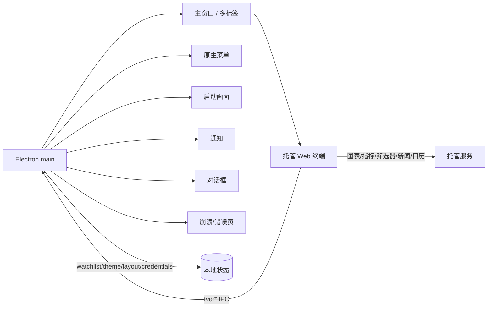

# TradingView Desktop 逆向分析报告

- 目标：TradingView Desktop `3.4.1.8194`（Windows x64 MSIX）
- 分析日期：2026-10-21
- 工具：REA `rea-agents 6.7.0`，`analyze-javascript-application`（静态、不执行）
- 证据文件：`reverse/tradingview/rea-analysis.json`（419.1 MB）
- 证据 SHA-256：`a70a18bfd8f1db8d113993709d8294344545a29b3ccf7f7c3436667907023906`

## 1. 结论

TradingView Desktop 是一个**薄 Electron 外壳 + 托管 Web 终端**的混合架构：

- 外壳负责窗口/标签页、菜单、主题、布局、通知、凭据、截图、报告、更新等原生能力；
- 图表、指标、筛选器、新闻、日历、Pine 编辑器等核心功能由托管网页端提供；
- 外壳通过一组 `tvd:*` IPC 通道与渲染进程通信，并保留了 Electron `remote` 模块风格的 `REMOTE_BROWSER_*` 通道。

这一结论来自静态应用图，不是运行时抓包；网页端的具体实现不在 `app.asar` 内，因此本报告不声称还原了图表引擎或指标算法。

## 2. 样本与方法

| 步骤 | 操作 | 结果 |
|---|---|---|
| 获取 | `winget download --id TradingView.TradingViewDesktop` | `TradingView_3.4.1.8194_X64_msix_en-US.msix` |
| 解包 | MSIX 按 ZIP 展开 | `TradingView.exe`（223 MB）+ `resources/app.asar`（38 MB） |
| 静态分析 | `rea analyze-javascript-application app.asar --format json` | 419 MB 证据 |
| 摘要 | 流式解析（UTF-16 LE） | `summary.json` / `app_facts.json` |

分析统计（REA `statistics`）：

- 相关文件 166 个；解析 JavaScript 文件 62 个；跳过 1 个；解析失败 0；
- 读取文本 24,078,155 字节；访问 AST 节点 888,069 个；
- 还原模块 1,896 个；发现（findings）6,621 条；
- 嵌套 ASAR 0 个；无非法 UTF-8 文件。

REA 明确限制：**JavaScript 仅作为数据解析，从未执行**。因此所有结论都是静态证据，运行时行为未验证。

## 3. 应用结构

`app.asar` 中的应用路径分为两类：

**主进程/多窗口入口**
- `app/main`（主窗口）
- `app/new-tab`（新标签页）
- `app/menu`（原生菜单）
- `app/splash`（启动画面）
- `app/tab-monitor`（标签页监控）
- `app/toast`（通知浮层）
- `app/dialog-window`（对话框）
- `app/crash-view` / `app/error-view`（崩溃/错误页）
- `app/licenses`（开源许可）
- `app/browser-api-container`（浏览器 API 容器）
- `app/renderer-services/drag-service`（拖拽服务）

**Webpack 代码块**
- `app/<id>.js` 与同名 `.js.map`，共 63 个 chunk / source map 资产；
- 运行时标识：`webpackChunktradingview_desktop`；
- 模块键为数字（如 `31544`、`93906`），说明是生产构建、压缩后的模块图。



## 4. IPC 通道

静态扫描得到 48 个通道，可分为：

| 类别 | 通道（示例） | 说明 |
|---|---|---|
| 会话/窗口 | `tvd:open-new-window`、`tvd:reload-tab`、`tvd:hide-menu`、`tvd:set-title` | 窗口与标签页控制 |
| 主题/布局 | `tvd:get-theme`、`tvd:set-theme-setting`、`tvd:update-theme`、`tvd:layout-change`、`tvd:layout-restored` | 主题与布局持久化 |
| 自选/观察列表 | `tvd:get-watchlist`、`tvd:watchlist-change` | 自选列表同步 |
| 凭据 | `tvd:get-credentials`、`tvd:set-credentials`、`tvd-main:initiate-sign-in`、`tvd-main:set-locale` | 登录与本地凭据 |
| 通知/报告 | `tvd:set-notification`、`tvd:set-notification-viewed`、`tvd:get-reports` | 通知与报告 |
| 截图/输入 | `tvd:screen-capture`、`tvd:get-screen`、`tvd:native-input-string`、`tvd:get-audio`、`tvd:get-camera` | 原生输入/媒体 |
| 调试/日志 | `tvd:log`、`tvd:send-to-sentry-breadcrumb`、`tvd:debug-auto-save-dialog` | 日志与错误上报 |
| Electron remote | `REMOTE_BROWSER_*`（14 个）、`REMOTE_RENDERER_CALLBACK`、`REMOTE_RENDERER_RELEASE_CALLBACK` | 旧式 remote 桥 |

安全观察：

- `REMOTE_BROWSER_*` 是 Electron `remote` 模块的典型通道集合，暴露了构造函数、成员读写、函数调用、`require` 等能力；若渲染进程可被注入，这类桥的攻击面显著大于 `contextBridge` 白名单。
- 静态证据显示存在 sender 校验：以 `t.webContentsId()` 与消息 sender 比较（`===` / `!==`），共 3 处；`enforcement` 字段为 `unknown`，不能据此断定校验完整。
- 未在静态图中发现 `browser_windows` 与 `context_bridge_apis`（均为空），但这不等于运行时不存在：动态注册、字符串拼接或托管页面内的 bridge 可能未被静态解析捕获。

## 5. 功能面（字符串计数，非功能证明）

对证据文本做词频统计，得到以下线索：

| 关键词 | 命中次数 | 解读 |
|---|---:|---|
| chart | 306 | 图表是核心域 |
| symbol | 366 | 标的/代码解析广泛存在 |
| alert | 161 | 告警能力 |
| calendar | 204 | 经济/财报日历 |
| indicator | 86 | 技术指标 |
| news | 77 | 新闻流 |
| screener | 61 | 筛选器 |
| replay | 51 | 历史回放 |
| pine | 52 | Pine 脚本编辑器 |
| fundamental | 45 | 基本面数据 |
| portfolio | 40 | 组合 |
| broker | 26 | 经纪商/交易接入 |
| watchlist | 12 | 自选列表 |
| order | 181 | 订单相关字符串 |

注意：

- `strategy`（35,747）与 `export`（2,931）明显混入压缩代码/通用词，不能当作功能计数；
- `forecast`、`technical`、`backtest`、`paper` 为 0，说明这些词不以字面量出现在外壳代码中，功能可能位于托管网页端；
- 以上是**词频线索**，不是功能已实现的证明。

## 6. 对我们 App 的启示

**采纳**
- 多窗口/多标签的桌面壳思路 → 我们采用单窗口 + 侧边导航，降低复杂度；
- 自选列表/布局/主题持久化 → 我们用 `localStorage` 保存当前标的与页面状态；
- 告警/信号 → 我们实现 RSI 极值、50 日均线穿越的规则信号；
- 筛选器 → 我们用板块/市场表格实现横截面筛选；
- 日历/新闻/基本面 → 我们以券商观点库与数据质量页替代，避免无来源数据。

**不采纳**
- `REMOTE_BROWSER_*` remote 桥：攻击面过大，改用本地 HTTP API + 白名单端点；
- 托管网页端黑盒：我们的分析逻辑全部本地可复现；
- 订单/经纪商接入：本项目不做交易执行，避免合规与资金风险；
- Pine/回放：超出 MVP 范围，明确列为后续工作。

## 7. 证据与复现

```powershell
# 1) 获取安装包（winget 会处理 CDN 鉴权）
winget download --id TradingView.TradingViewDesktop --download-directory .\reverse\tradingview

# 2) 解包 MSIX（本质是 ZIP）
Copy-Item .\reverse\tradingview\*.msix .\reverse\tradingview\tv.zip
Expand-Archive .\reverse\tradingview\tv.zip .\reverse\tradingview\extracted

# 3) 静态分析
rea analyze-javascript-application .\reverse\tradingview\extracted\resources\app.asar `
  --format json --max-heap-mb 2048 --analysis-timeout-ms 600000 > .\reverse\tradingview\rea-analysis.json

# 4) 摘要（处理 PowerShell 的 UTF-16 输出）
py .\scripts\summarize_rea.py
py .\scripts\extract_app_facts.py
```

产物：

- `reverse/tradingview/summary.json`：统计、限制、Electron 边界样本；
- `reverse/tradingview/app_facts.json`：IPC、路径、模块键、关键词；
- `reverse/tradingview/extracted/resources/app.asar`：保留的 ASAR（完整应用可从 MSIX 重新解包）。

## 8. 局限

1. 静态分析未执行代码，无法确认运行时实际使用哪些通道、哪些分支可达。
2. `app.asar` 只包含 Electron 外壳；图表/指标/筛选器/新闻等核心逻辑在托管网页端，未纳入本次证据。
3. IPC 通道名来自字符串与 wrapper 替换，可能存在误报/漏报；`enforcement` 未验证。
4. 关键词计数受压缩代码与通用词影响，只能作为线索。
5. 未做网络抓包/证书固定分析；未评估登录态、加密存储与更新机制。
6. 目标版本会更新；本报告只对应 `3.4.1.8194`。

---

**一句话总结**：TradingView Desktop 的可复用价值在“桌面壳的原生集成模式”，而不是其图表算法；我们复用了多市场/自选/信号/筛选的产品结构，但用本地可复现的数据与模型替代了黑盒托管逻辑。
